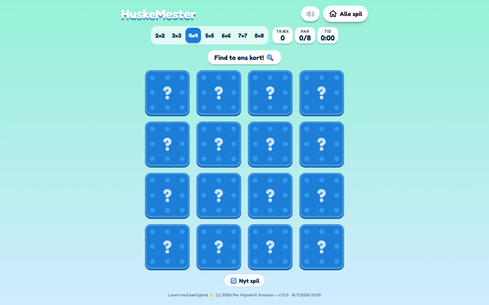

# HuskeMester


[](LICENSE)



**A memory game for children (about 3–10 years): turn two cards at a time and find the pairs.**

▶️ **Play it:** <https://kreaton.github.io/KidsGames/huskemester/>

It is a Blazor WebAssembly app (.NET 10) that runs entirely in the browser, with no server or backend. The game itself is in Danish.

## How to play

Pick a board from **2×2** to **8×8** at the top and tap a card to turn it. Tap a second card:

- **The same picture:** the two cards stay up with a green ring, and you hear a ping.
- **Different pictures:** they get an orange ring, shake, and turn back after about a second.

Find all the pairs to win. The pictures from the game then rain down the screen, and **Spil igen ➜** deals a new board.

Every game picks new pictures at random from about 90 child-friendly emoji (animals, fruit and food, vehicles, toys and plants). No picture is used twice in a game, so even 8×8 has 32 different pairs.

On an odd board (3×3, 5×5, 7×7) one cell is left over, so the middle cell is a free star ⭐.

## Score

**Træk** (moves) counts each pair of cards turned, **Par** (pairs) shows how many are found, and **Tid** (time) starts with the first card. The fewest moves on each board size is kept as a record, shown when the board is cleared.

The board size and the records are remembered in the browser.

## Keyboard

Every card is a button: `Tab` moves between them, and `Enter` or `Space` turns one.

## Project layout

```
HuskeMester.slnx
src/HuskeMester/
  Game/MemoryGame.cs        The deck, the free star and the rules for a move
  Pages/Home.razor          The board, the size picker, the stats and the win screen
  wwwroot/
    index.html              Host page, <base href>
    css/app.css             All styling and animations
    js/huske.js             The saved board size and records
    js/sounds.js            Card flips, pair pings, try-again bonks and the fanfare (Web Audio API, no audio files)
    manifest.webmanifest
    icons/                  App icons and favicon
tools/make-icons.ps1        Draws the icons
```

## Running locally

Requires the [.NET 10 SDK](https://dotnet.microsoft.com/download).

```bash
dotnet run --project src/HuskeMester
```

Then open http://localhost:5329.

Stop the app before building it again. A running dev server keeps the list of files it started with, and after a rebuild the page can hang on "Indlæser".

## Publishing

Pushing to `main` builds the app and puts it in the `huskemester/` folder of the KidsGames GitHub Pages site (<https://kreaton.github.io/KidsGames/huskemester/>) with [`.github/workflows/deploy.yml`](.github/workflows/deploy.yml). It needs the repository secret `PAGES_DEPLOY_KEY`: the private half of a deploy key with write access to `kreaton/KidsGames`.

The app is served from a `huskemester` sub-path: `<base href>` in [`wwwroot/index.html`](src/HuskeMester/wwwroot/index.html) is `huskemester`.

The front page card is in `KidsGames/index.html`. `tools/make-icons.ps1 -FrontPageDir ..\KidsGames\billeder` copies the icon there.

## License

[MIT](LICENSE) © 2026 Per Hejndorf, Kreaton
